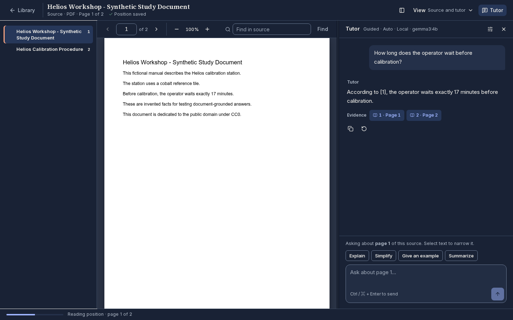
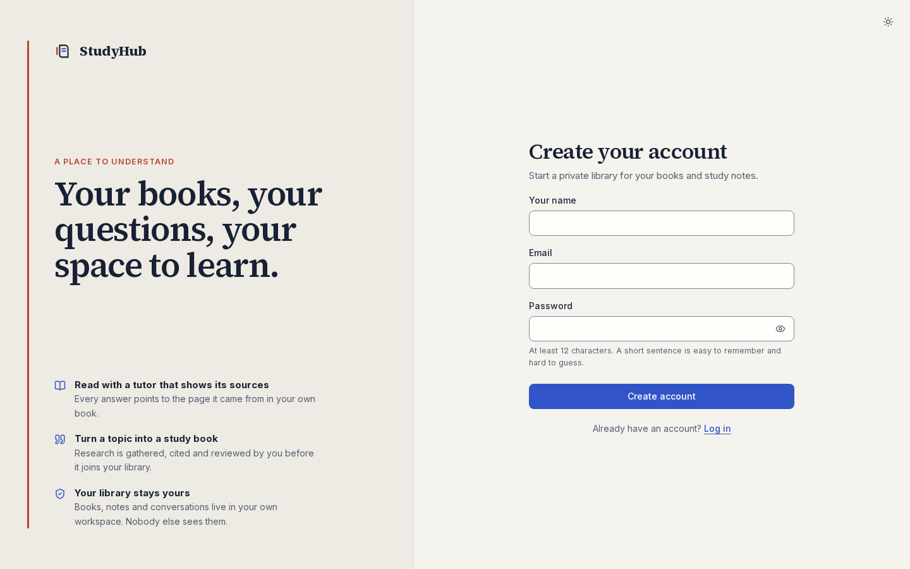
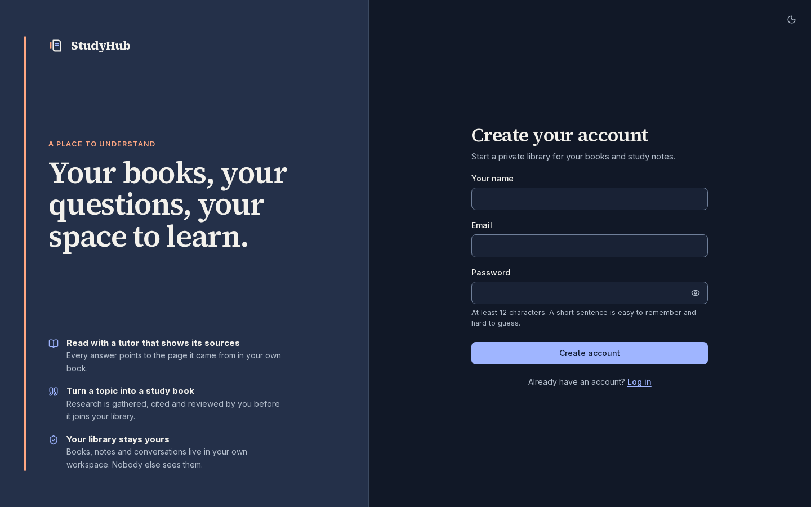
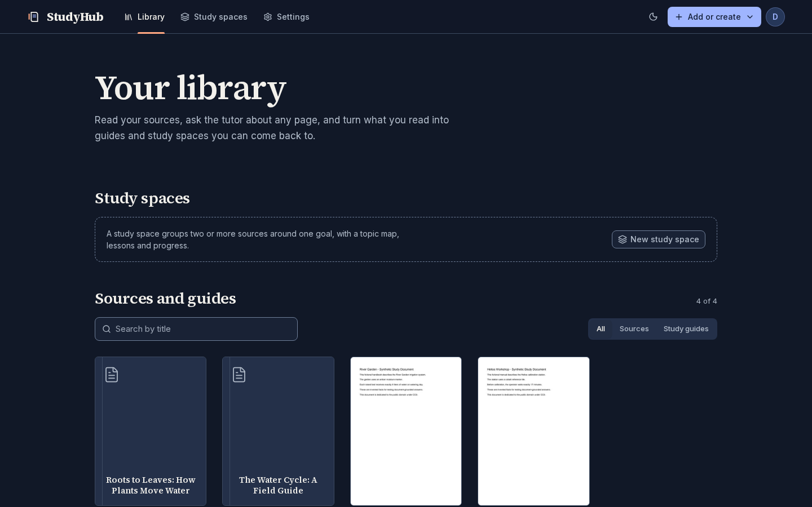
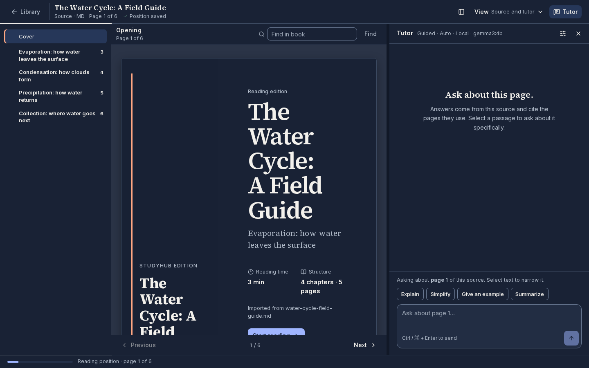
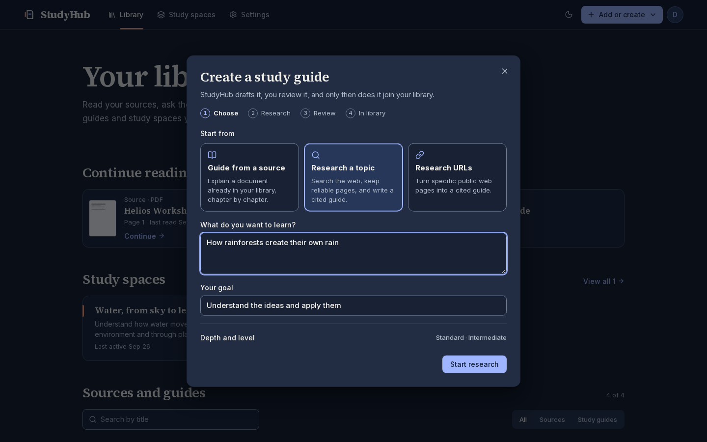
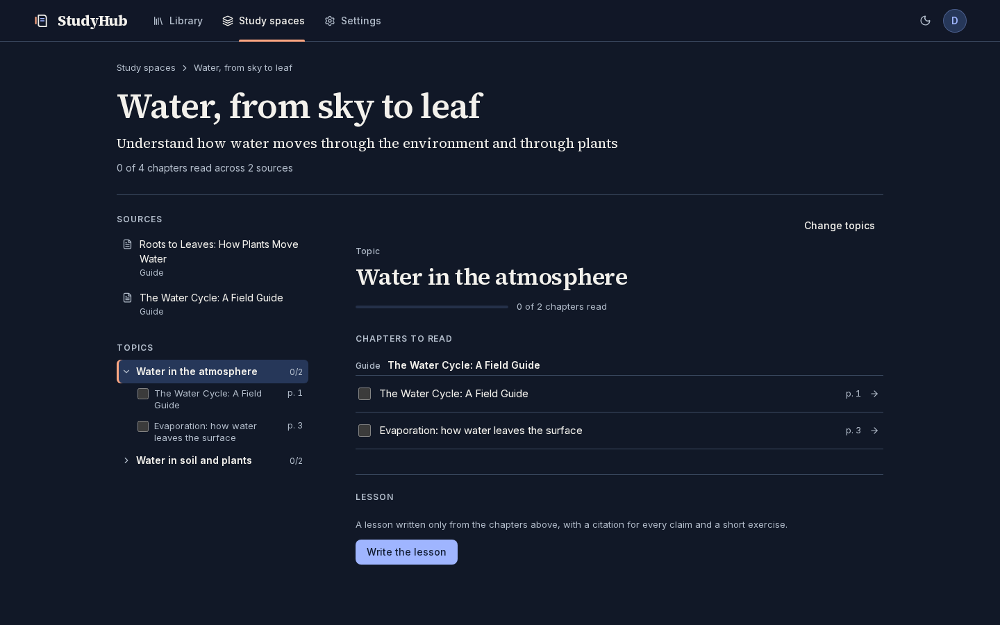
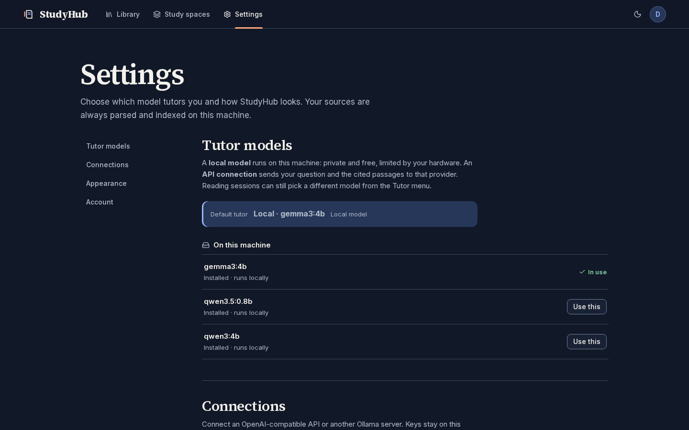

<p align="center">
  
</p>

<h1 align="center">StudyHub</h1>

<p align="center">
  <strong>Your books, your questions, your space to learn.</strong><br>
  An open-source study workspace where a tutor reads your own sources with you and shows you the page behind every answer.
</p>

<p align="center">
  
</p>

---

## What is StudyHub?

Most AI study tools answer from somewhere you cannot check. StudyHub starts from the other end: you bring the material (a textbook, a paper, your course notes) and everything the tutor says is grounded in it, with links back to the exact pages.

It is built for people who learn from long, serious sources and want to keep going with them over weeks, not minutes. It remembers where you stopped, it can turn a topic into a reviewed study book, and it can map several books onto one learning goal.

StudyHub is self-hosted. It runs on your own machine with Docker, uses a local model through Ollama by default, and can use any OpenAI-compatible API if you prefer. Several people can share one installation, each with a private library.

## A quick tour

### Create your account

The front door is a sign-up page. Each person gets a private workspace, and the first account on a new installation becomes its administrator.

<p>
  
  
</p>

### Build your library

Drop in PDFs, Markdown, plain text or Word files. StudyHub keeps the original, extracts the text and structure (chapters, headings, figures), and indexes it for questions. The same file uploaded twice is stored once.



### Read with a tutor beside you

Open any source and ask about the page you are on, or select a passage and ask about just that. Pick how the tutor teaches (guided, Socratic, deep dive or practical), and use one-click actions to explain, simplify, give an example or summarize. Every answer lists its evidence; click a citation and the reader jumps to that page. Your place, layout and conversation are saved, so **Continue** takes you right back.

### Read generated guides as real books

Markdown sources and generated guides open as a paginated digital book, with a cover, a table of contents and reading time, rather than one long scroll.



### Research a topic into a study book

Type what you want to learn, or paste a few public links. StudyHub plans the subject, searches the web, keeps only readable and relevant sources, and drafts a guide in which every claim cites its source. Nothing enters your library until you have reviewed the draft and approved it.



A **learning companion** does the same for a book you already own: it walks the book chapter by chapter, adds exercises, and offers videos, playlists and articles it has checked are real and on topic. You choose which of those to keep.

### Study across several books

A **study space** gathers two or more sources around one goal. StudyHub proposes topics (or you type your own), files each real chapter under the topic it fits best, and tracks what you have read. For each topic it can write a short lesson drawn only from those chapters, with a citation for every claim and an exercise that it marks for you.



### Choose your tutor

Use a model that runs locally, which is private and free, or connect an OpenAI-compatible API. API keys are encrypted at rest and never sent back to the browser. The administrator manages which local models are installed; everyone else chooses among them. The Account section is where you delete your account; you can change your mind by logging in again within 30 days.



## Under the hood

| Part | What it does |
| --- | --- |
| **Web** (Next.js, React) | The reader, library, study spaces and settings |
| **API** (FastAPI) | Accounts, workspaces, retrieval, tutoring, research |
| **Worker** | Parsing, indexing and research in the background; scale it with more copies |
| **PostgreSQL + pgvector** | All data and search vectors, isolated per workspace by the database itself |
| **Docling** | Text, structure and OCR from PDFs and Word files |
| **Ollama** | Local embeddings and, by default, the local tutor |
| **SearXNG** | Private web search for research |

A few choices matter if you plan to build on StudyHub:

- **Ownership is enforced by the database.** Every record belongs to a workspace, relationships cannot cross workspaces, and row-level security hides other tenants even if a query forgets to filter.
- **Content is versioned.** A book's bytes, its parsed text and its search vectors are stored as separate versions, so upgrading the parser or the embedding model never changes what an old citation points to.
- **Background work is fenced.** Jobs survive restarts, retry with backoff, and a stalled worker can never overwrite a newer result.

## Getting started

You need Docker with Compose. A GPU helps the local tutor but is not required.

Create a file named `.env` next to `compose.yaml` with these values. Each secret should be a long random string, for example the output of `openssl rand -hex 24`:

```sh
POSTGRES_OWNER_PASSWORD=...        # database owner, used only for migrations
STUDYHUB_APP_DB_PASSWORD=...       # the API's database role
STUDYHUB_WORKER_DB_PASSWORD=...    # the background worker's database role
STUDYHUB_SECRET_KEY=...            # 32 random bytes, base64: openssl rand -base64 32
SEARXNG_SECRET=...                 # signs the search service's requests
```

Keep `.env` private and back up `STUDYHUB_SECRET_KEY` with your database backups; saved API keys cannot be decrypted without it. Optional settings (ports, the tutor and embedding models, a hosted LLM, sign-up, retention periods) have sensible defaults in `compose.yaml`.

```sh
docker compose up -d

# One-time model downloads, kept in a Docker volume:
docker compose exec ollama ollama pull embeddinggemma:300m
docker compose exec ollama ollama pull gemma3:4b
```

Open http://localhost:3001 and create your account.

## Where it is heading

| Stage | Status |
| --- | --- |
| Library, reader, cited tutor, research, learning companions, study spaces | Available |
| Accounts, private workspaces, PostgreSQL + pgvector, background workers | Available |
| Trash and restore in the interface (the API already supports both), and permanent clean-up after the 30-day grace period | Next |
| Team workspaces with invitations, roles and shared libraries; usage limits | Planned |
| Cross-library search, mastery tracking, spaced review | Planned |

The screenshots were taken from a demo account holding only synthetic, public-domain material, not anyone's real library.
